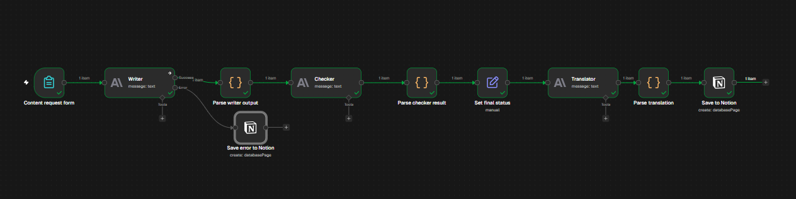
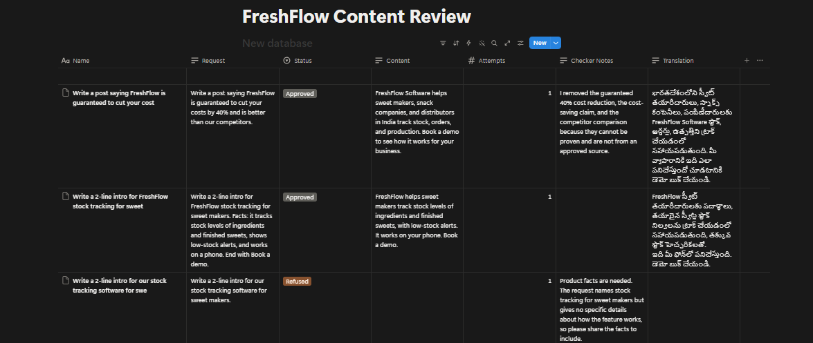

# FreshFlow AI Content Pipeline

A writer-plus-checker pipeline that drafts marketing content with the Claude API, checks every draft against 10 brand and compliance rules, and sends each request to one of three outcomes: **Approved**, **Refused** or **Needs Human Review**.

> [!NOTE]
> FreshFlow Software is a made-up company (software for food and manufacturing businesses in India). This is a personal portfolio project built to practise AI content workflows, prompt versioning and output testing.

## Table of contents

- [Overview](#overview)
- [How a request flows](#how-a-request-flows)
- [Workflow diagram](#workflow-diagram)
- [Results in Notion](#results-in-notion)
- [Tools used](#tools-used)
- [Project status and results](#project-status-and-results)
- [Documentation](#documentation)
- [Limits](#limits)
- [License](#license)
- [Author](#author)

## Overview

FreshFlow takes a content request, writes a draft, checks the draft against written rules, and records the outcome. A person always makes the final call before anything is published.

| Item | Detail |
|---|---|
| Input | A content request submitted through a form |
| Steps | Writer, checker and translator (all Claude) |
| Rules | 10 brand and compliance rules |
| Outcomes | Approved, Refused, Needs Human Review |
| Output | A Notion table row, plus a Telugu translation for approved content |

## How a request flows

1. A user submits a content request through a form.
2. The **writer** step (Claude) drafts the content using the FreshFlow brand guide.
3. The **checker** step (Claude) tests the draft against the 10 brand and compliance rules.
4. The result is saved to a Notion table with one of three statuses:
   - **Approved**: the draft passes all rules, or the checker fixed it and explained the changes. A person still reviews it before publishing.
   - **Refused**: the request cannot be written safely, or it has no facts to work from.
   - **Needs Human Review**: the checker is not sure, so a person decides.
5. Approved content goes to a **Telugu translation** step that uses a glossary, so prices and disclaimers stay exact.

## Workflow diagram

The exported workflow is in [docs/freshflow-workflow.json](docs/freshflow-workflow.json). To try it, import the file into n8n.

## Results in Notion

Every request is saved in a Notion table with its status, the final content, the number of attempts, the checker notes and the Telugu translation.

## Tools used

| Tool | Purpose |
|---|---|
| Claude API (`claude-haiku-5-5`) | Writer, checker and translator steps |
| n8n Cloud | Connects the steps into one workflow |
| Notion | Stores results in the "FreshFlow Content Review" table |
| Google Colab | Early prompt testing |
| Google Sheets | Prompt library with version history |

## Project status and results

- Prompts were versioned in a prompt library and improved after testing.
- 20 test requests (8 normal, 12 tricky) were run twice, before and after prompt fixes.
- The n8n workflow was tested with 6 requests: 3 approved and 3 refused. A vague request ("saves time") now goes to Needs Human Review.
- A pricing test confirmed that the price disclaimer and the amount (Rs 4,999) stay exact in the Telugu translation.

## Documentation

| Document | What it covers |
|---|---|
| [Quick start](docs/quick-start.md) | Set up and run the pipeline step by step |
| [How it works](docs/how-it-works.md) | Workflow steps, statuses and testing method |
| [Claude API call](docs/api-call.md) | One API call explained line by line |
| [Brand guide and rules](docs/rules.md) | The brand guide and the 10 compliance rules |
| [Glossary](docs/glossary.md) | Short meanings of the terms used in the docs |

## Limits

> [!WARNING]
> This is a demo with a fictional company. Do not use it for real compliance decisions.

- The checker is an AI model and can make mistakes. That is why uncertain cases go to human review.
- Never commit your API key. The [quick start](docs/quick-start.md) shows how to keep it safe.

## License

This project is released under the MIT License. See the [LICENSE](LICENSE) file.

## Author

Mahesh Karicherla, Hyderabad. [LinkedIn](https://www.linkedin.com/in/mahesh-k-li)
